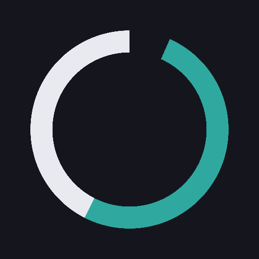
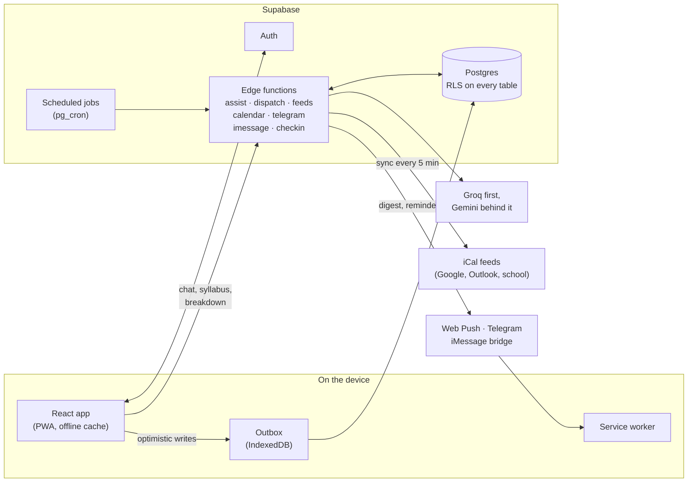

<div align="center">



# Planner

**A student planner that answers "what do I do right now" the moment it opens.**

Deadlines, classes, a daily checklist and an AI companion in one installable
app, built so that it stays easy to open on a bad week.


[Features](#features) ·
[How it works](#how-it-works) ·
[Getting started](#getting-started) ·
[Project layout](#project-layout) ·
[Testing](#testing) ·
[Design principles](#design-principles)

</div>

---

## Why it exists

A technically correct planner that feels like a chore is a failed planner, and
the failure is silent: one day it stops getting opened. Planner is built
against that failure. The common actions (capture a thought, tick something
off, see what is next) never gain a required step, and the deeper tools sit
one tap away for whoever wants them.

It is meant to replace the usual stack of Notion, Todoist, Google Calendar and
MyStudyLife with one place that already knows your courses, your timetable and
your deadlines.

## Features

### Today, at a glance

- **A widget board** that opens straight to what matters: next due, the class
  under way or up next, open assignments with a tick on every row, and the
  next seven days. Twenty widgets in six sizes (clock, countdown, focus timer,
  term progress, goals, marks so far, quick capture, photo, Spotify and more),
  arranged by holding and dragging.
- **Capture in plain language.** "Lab report fri 5pm" becomes dated work; a
  preview shows exactly what was read before anything is saved, and anything
  that is not clearly a date stays a thought in the inbox.
- **A daily checklist** as a row of tick pills, with back-filling for days you
  missed.
- **Low-battery mode** for the worst days: only what you marked
  non-negotiable plus one small piece of work that is due soon.

### Schedule and calendar

- **Schedule**: overdue work, each day of the week, later, undated work, stuck
  work and the inbox, all in one list.
- **Week** in five styles (rail, bubble, hours, ticket, ledger) and a **Month**
  view, with drag to reschedule and undo.
- **Classes typed by hand** as a weekly series with skipped days and term
  dates, correct across daylight-saving changes.
- **Live calendar feeds** from Google Calendar, Outlook or a university iCal
  address, re-synced every five minutes, with course linking, exam detection
  and duplicate removal.
- **A subscribable .ics feed** that puts your deadlines in the calendar app
  already on your phone.

### Courses and grades

- **Course pages** with what is coming up, office hours, contacts, links,
  notes and the syllabus as it was read.
- **Grade tools** that compute exactly what you ask ("what do I need on the
  final", what-if scenarios) and show the arithmetic, never a verdict.
- **Syllabus import** from text, PDF or photo. Dates are never guessed: "Week
  6" and "TBD" come back undated, and every extracted date is shown for
  confirmation before it is written.
- **Repeating work** (a weekly lab, a biweekly problem set) set up once as a
  pattern you can end, re-date or delete later.
- **Exam prep plans** and suggested study blocks placed in your free time.

### Abood, the AI companion

- **Chat that answers only from your own data**: open work, upcoming events,
  today's checklist and course pages. It must cite what it used, and anything
  it was not given becomes an honest "I don't have that".
- **Every change is a proposal.** Creating or moving work through chat is
  shown for confirmation before it touches the database.
- **"What now?"** picks one task for the time you have and says why.
- **Task breakdown** turns an assignment into four or five concrete first
  steps and rejects vague ones like "research the topic".
- **Text it on Telegram or iMessage** (through a Mac bridge), with a memory of
  stated preferences you can review and forget from Settings.

### Notifications

- **A daily digest** at the time you choose, by Web Push or Telegram.
- **Per-item reminders**, never sent for something already done.
- **Exam escalation** the night before, for exams and presentations only.
- **An optional weekly review** that names what you finished and never what
  you missed.

### Make it yours

- **Ten themes**: Cloisonné, Letterpress, Instrument, Fjord and Contrast, each
  designed as a light and dark pair and held to WCAG 2.1 AA contrast.
- **Modules you can switch off** (Abood, Briefing, Grades, Repeating work,
  Calendar feeds, Low-battery mode). Off hides; it never deletes.
- **Appearance settings** for glass, blur, slip style and motion, with full
  support for Reduce Motion.
- **Command palette** (Cmd/Ctrl + K), global search, keyboard shortcuts and
  data export.
- **Works offline.** Writes queue on the device and sync when you are back,
  and a failed sync is always shown and recoverable.
- **Runs everywhere**: phone, iPad (three layouts by width) and desktop, as an
  installable web app, with an iOS build through Capacitor.

## How it works



**The client is optimistic, the server is the truth.** Every write is
recorded in an outbox on the device and applied to the screen at once, then
sent to Supabase. Transient failures retry with backoff; a write the server
refuses is set aside in a review sheet with Try again and Discard, so one bad
write never blocks the rest.

**Every account is isolated.** Row-level security (`auth.uid() = user_id`)
is on every table, and no database function accepts a user id from its
caller. Edge functions run per request and scope every query by account.

**Time is always your own.** A "day" is your local day in your account's time
zone, never UTC and never a hardcoded city, and it survives daylight-saving
changes. Server time functions take a zone with no default, so a call without
one fails to compile.

**The AI never writes on its own.** Syllabus dates, task breakdowns and chat
actions are proposals. Text work goes to Groq first and falls back to Gemini;
PDFs, photos and memory embeddings use Gemini. Usage is metered per account
per day, and an account can bring its own API keys.

## Tech stack

| Layer | Choice |
| --- | --- |
| Front end | React 19, TypeScript, Vite, Tailwind CSS 4 |
| App shell | Installable PWA with a service worker; iOS build via Capacitor |
| Backend | Supabase: Postgres, Auth, row-level security, Deno edge functions, pg_cron |
| AI | One swappable module: Groq (text) with Gemini fallback, Gemini for documents and embeddings |
| Notifications | Web Push, Telegram bot, iMessage through a Mac bridge |
| Hosting | Vercel |
| Testing | Vitest, PGlite for migrations, Playwright and axe for end to end and accessibility |

There is deliberately no router library and no animation library. Routing is
a small hand-rolled layer over browser history, and motion is played by the
browser through the Web Animations API (`src/lib/motion.ts`).

## Getting started

You need Node.js 22 (`nvm use` reads `.nvmrc`), a free [Supabase](https://supabase.com) project, and
optionally a Telegram bot. The full walkthrough, including where to find
every value, is in **[SETUP.md](SETUP.md)**.

```bash
# 1. Install
npm install

# 2. Describe your Supabase project
cp .env.setup.example .env.setup   # fill in the values it asks for

# 3. Provision: links the project, applies migrations, deploys edge
#    functions, generates push keys and wires the schedule
npm run setup

# 4. Run the app
npm run dev
```

`npm run setup` is safe to re-run. Leaving the personal fields out of
`.env.setup` sets up a shared environment where people sign up for
themselves; filling them in also creates your own account.

### Useful scripts

| Command | What it does |
| --- | --- |
| `npm run dev` | Start the app locally |
| `npm run build` | Typecheck and build for production |
| `npm run check` | Lint, build, unit tests and Deno checks (run before every push) |
| `npm test` | Unit tests |
| `npm run test:tz` | Unit tests under five host time zones |
| `npm run e2e` | End-to-end tests in Chromium (phone, desktop, iPad) |
| `npm run test:notify` | Send a test notification to your phone |
| `npm run ios:sync` | Build and sync the optional native iOS shell (sets the UTF-8 locale CocoaPods needs) |

## Project layout

```text
src/
  routes/          Screens: Today, Week, Month, Plan, Chat, Settings, ...
  components/      Shared UI, the widget board and the calendar styles
  lib/             Outbox, optimistic layer, time, routing, motion, parsing
  styles/          Tokens (the only place a colour is written) and materials
supabase/
  migrations/      Schema, RLS policies and functions, in order
  functions/       Edge functions and the shared server modules
bridge/imessage/   The Mac bridge that lets Abood answer iMessages
tests/             Structural guards (reachability, palette, motion, markup)
e2e/               Playwright specs and an in-memory sample account
docs/              The original spec and the design system
ios/               Capacitor iOS project
```

## Testing

- **Unit tests** (Vitest) cover the time layer across DST, capture parsing,
  syllabus validation, the outbox, recurrence expansion and the AI
  validators.
- **Migration tests** run every migration on PGlite with Supabase's default
  privileges, and fail if any function could act on another account.
- **Structural guards** fail the build on a component nothing renders, a
  table nothing reads, a colour written outside the token file, any text
  pairing below WCAG AA in any theme, or a reduced-motion rule that removes
  an animation instead of softening it.
- **End-to-end tests** (`npm run e2e`) drive the real app at phone, iPad and
  desktop sizes against an in-memory sample account on a fixed clock, and
  any console error fails the test. Axe checks accessibility on every main
  screen in both modes and in every theme.

## Design principles

A few rules shape every decision. The full set lives in
[CLAUDE.md](CLAUDE.md).

1. **Today is the default view.** Opening the app answers "what do I do right
   now" in under two seconds, with no navigation.
2. **Minimum required fields.** If a field can be optional, it is.
3. **Never silently lose data, never silently write.** Failed syncs are
   visible and recoverable; AI output is confirmed before it is saved.
4. **No guilt.** Streaks are an opt-in module, off by default. Missed days
   are shown neutrally and can be back-filled.
5. **Colour carries meaning by role.** Urgency, courses and brand never blur
   into one another, there is no pure red, and colour is never the only
   signal.
6. **Every tap that changes something is animated**, and Reduce Motion turns
   travel into a fade rather than a cut.
7. **Built for one, architected for many.** If a second account signing up
   tomorrow would make something wrong, it is wrong now.

## Documentation

- [SETUP.md](SETUP.md) — provisioning a Supabase project and deploying
- [PRODUCT.md](PRODUCT.md) — who the product is for and how it is positioned
- [docs/design-system.md](docs/design-system.md) — tokens, type and materials
- [docs/spec.md](docs/spec.md) — the original brief, kept as history
- [e2e/TEST-PLAN.md](e2e/TEST-PLAN.md) — what the end-to-end suite covers
